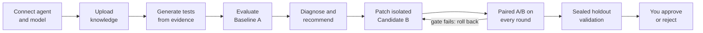
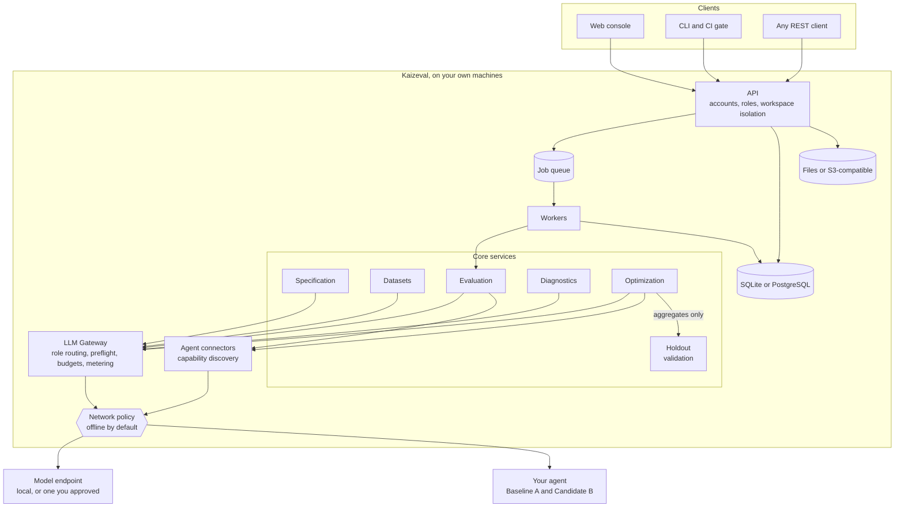
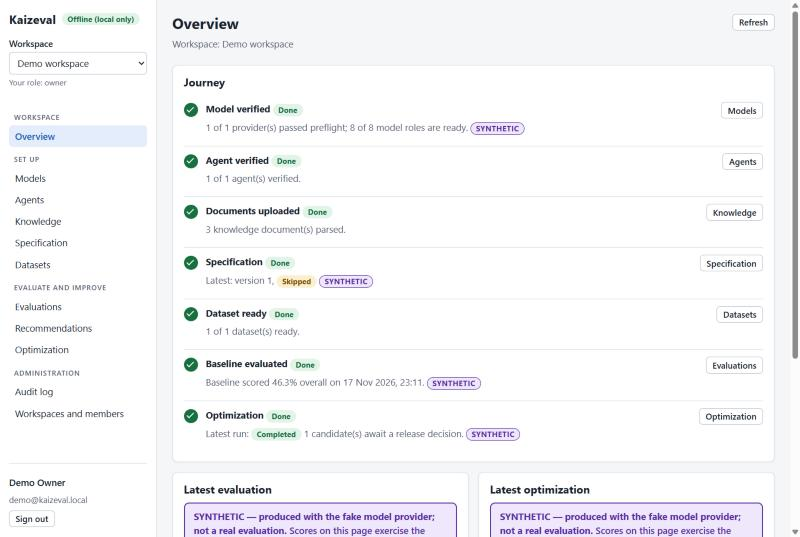
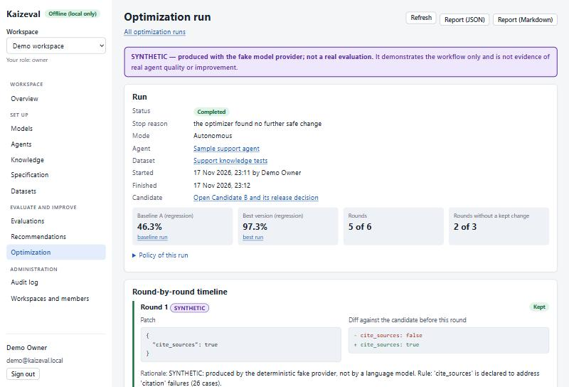
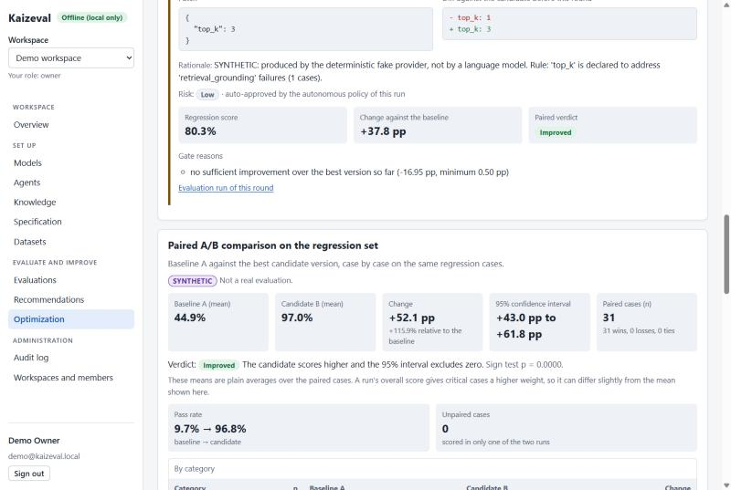

# Kaizeval

**Evaluate. Diagnose. Optimize. Repeat.**

Kaizeval tests your AI agent against its own knowledge base, tells you where and why it fails,
and, when the agent allows it, improves an isolated copy and proves the gain on questions the
optimizer never saw. It runs entirely on your own machines, and works with no internet access.

[](https://github.com/abdullahahmed94/kaizeval/actions/workflows/ci.yml)
[](LICENSE)


## How it works



Agents that cannot be patched safely stop after "Diagnose and recommend": you get the report and
the recommendations, and Kaizeval says why nothing more is offered. The full journey, the scoring
pipeline and one optimization round are drawn step by step in [docs/WORKFLOW.md](docs/WORKFLOW.md).

### Architecture



One Python package runs as a single process on a laptop, or as API and worker containers with
PostgreSQL. Details and design decisions: [docs/ARCHITECTURE.md](docs/ARCHITECTURE.md).

## Why Kaizeval

Most evaluation tools stop at a score. Kaizeval is built around what happens next:

- **A closed, controlled loop.** Findings become recommendations; recommendations become
  allowlisted changes to a *candidate copy*; every change re-runs the whole regression set and is
  kept only if it passes your gates. Your production agent is never touched and nothing is
  promoted without an explicit approval.
- **Results you can defend.** Deterministic checks and human-approved references outrank model
  judges. Every A/B comparison comes with a confidence interval and a plain verdict:
  *improved*, *regressed* or *inconclusive*. A final holdout set stays sealed from the optimizer.
- **Private by default.** Self-hosted, no telemetry, no license check. Offline mode is on by
  default and refuses any non-local destination before a DNS lookup is even made. Use a local
  model (Ollama, vLLM, anything OpenAI-compatible), or opt in to a remote provider per workspace.
- **Honest about what it cannot do.** A black-box agent gets recommendations only, with the
  reason shown. Unobservable things are reported as "not scored", not guessed.

Kaizeval is not a hosted service, a vector database or an observability platform, and it
works alongside the evaluation and tracing tools you already use.

## Try it in a minute

Requires Python 3.10+. No Docker, no API key, no account.

```bash
pip install https://github.com/abdullahahmed94/kaizeval/releases/download/v0.1.0/kaizeval-0.1.0-py3-none-any.whl
kaizeval demo
```

`kaizeval demo` starts the console at <http://127.0.0.1:8000> and a small sample support agent,
then runs the complete journey against it and prints a login.

> **About the demo numbers.** The demo uses a built-in **fake model provider** so it can run
> without any model. Scores that come from it are text-overlap heuristics and are labelled
> **SYNTHETIC** everywhere. What is real in the demo: a separate agent process is called for every
> test, the deterministic checks measure its actual answers, the candidate is a real isolated
> copy, and the baseline stays byte-identical. Connect a real model to get real judgments.

## What it looks like

Screenshots of the bundled console running the demo. The purple banners are the SYNTHETIC label
that every fake-provider result carries.

| Journey overview | Optimization run | Paired A/B comparison |
|---|---|---|
|  |  |  |

## Use it through the API

Everything the console does is a REST call, so the whole journey can be scripted. A complete
walkthrough that needs only the Python standard library is in
[`examples/api_quickstart.py`](examples/api_quickstart.py):

```bash
kaizeval serve                         # terminal 1: API on http://127.0.0.1:8000
kaizeval sample-agent --port 8101      # terminal 2: something to evaluate (or use your own agent)
python examples/api_quickstart.py      # terminal 3
```

```text
2. Register the agent as a black box and verify the connection
  POST   /workspaces/{ws}/agents                      ->  201
  POST   /workspaces/{ws}/agents/{id}/verify          ->  200
4. Run a deterministic evaluation (no model needed) and wait for the job
  POST   /workspaces/{ws}/evaluation-runs             ->  202
  GET    /workspaces/{ws}/jobs/{id}                   ->  200
     overall 57.1%  pass rate 50.0%  critical failures 0  cases 6
5. Read per-case results, findings and recommendations
     FAIL  How long is the compressor covered under warranty?  ->  correctness=0.0 (0/1 key facts present (approved reference))
     - Add an explicit rule to decline when no supporting evidence is found [instruction_prompt, 2 case(s)]
       auto-apply: False  reason: UNSUPPORTED_CAPABILITY: a black-box HTTP agent cannot be patched; apply this change yourself
```

That run uses no model at all: the scores come from deterministic checks of the sample agent's
real answers against approved references. All routes, error codes and payloads are in
[docs/API.md](docs/API.md); the OpenAPI document is served at `/api/openapi.json`.

## Use it with your own agent and model

```bash
kaizeval serve          # console and API on http://127.0.0.1:8000
```

1. **Model.** Models → add an *OpenAI-compatible* provider, for example a local Ollama server at
   `http://localhost:11434/v1` with your model's name → **Verify** → set as default.
   (Deterministic evaluation works with no model at all.)
2. **Agent.** Agents → *Generic HTTP chat endpoint*. Point it at any endpoint that accepts a
   message and returns an answer, or at an OpenAI-style `/chat/completions` endpoint.
3. **Knowledge.** Upload the PDF, DOCX, Markdown or text files your agent answers from.
4. **Tests.** Generate evidence-linked cases, and/or import your own approved Q&A or real
   conversations as CSV or JSON Lines.
5. **Evaluate.** Choose deterministic, single judge, or dual judges with an arbiter.
6. **Improve.** Read the findings and recommendations. If your agent implements the
   [candidate protocol](docs/CONNECTOR_SDK.md) (a handful of HTTP endpoints), let Kaizeval
   optimize a candidate under your rules, then approve or reject the result.

## Use it in CI

Fail a pull request when your agent gets worse:

```bash
kaizeval ci --url https://kaizeval.internal --workspace $WS --agent $AGENT --dataset $DATASET \
  --fail-under 0.85 --max-critical 0 --baseline-run $LAST_GOOD_RUN
```

Exit code `0` passes, `1` means a quality gate failed, `2` is an operational error. As a GitHub
Action:

```yaml
- uses: abdullahahmed94/kaizeval@v0.1.0
  with:
    url: ${{ vars.KAIZEVAL_URL }}
    email: ${{ secrets.KAIZEVAL_EMAIL }}
    password: ${{ secrets.KAIZEVAL_PASSWORD }}
    workspace: ${{ vars.KAIZEVAL_WORKSPACE }}
    agent: ${{ vars.KAIZEVAL_AGENT }}
    dataset: ${{ vars.KAIZEVAL_DATASET }}
    fail-under: "0.85"
```

## What is included

| Area | What you get |
|---|---|
| Agents | Generic HTTP and OpenAI-compatible connectors (black box); a candidate protocol for agents that can be safely patched; capability discovery with reasons |
| Models | One gateway for eight roles (generator, reference drafter, two judges, arbiter, root cause, optimizer, spec inference); preflight; budgets; per-role usage; no silent fallback |
| Knowledge | PDF, DOCX, Markdown, text; versioned; every passage traceable to file, page or section and offsets |
| Specification | From your requirements, inferred, or both; versioned; Review & Edit, Approve or Skip |
| Tests | Knowledge, citation, edge-case, multi-turn and unanswerable cases; language variants (needs a real model); import of approved Q&A; coverage report; stale-case detection when a document changes |
| Evaluation | Deterministic-first scoring; single or dual judges with arbiter; critical-failure gates; "needs human review" and "not scored" as first-class outcomes |
| Diagnosis | Findings that separate observation from hypothesis; prioritised recommendations with a review workflow |
| Optimization | Human-guided or autonomous; allowlisted patches on an isolated candidate; full regression each round; rollback; budgets, stagnation and cancellation |
| Validation | Paired A/B with bootstrap confidence interval; sealed, rotatable holdout; explicit approval, promotion and rollback |
| Operations | Roles (owner, editor, reviewer, viewer); audit trail; encrypted credentials; JSON and Markdown reports; REST API; CLI; GitHub Action |

Console pages: Overview, Models, Agents, Knowledge, Specification, Datasets, Evaluations,
Recommendations, Optimization, Candidates, Audit, Workspace settings.

## Deploy

- **Single node:** `pip install` + `kaizeval serve` (SQLite, local files).
- **Docker Compose:** API, workers and PostgreSQL; optional MinIO; a network-isolated variant for
  air-gapped sites. See [docs/INSTALL.md](docs/INSTALL.md).

## Limitations

Kaizeval is **alpha** software. Please read these before relying on it.

- A score on generated tests describes behaviour on those tests. It is not real-world accuracy.
- Model judges are estimates and can be wrong or biased. Two judges agreeing is not proof.
- Automatic optimization works only for agents that implement the candidate protocol. No
  vendor-specific connector is included; arbitrary platforms are evaluated as black boxes.
- Release 0.1.0 was not run against a real model server or under Docker on the machine that
  prepared it. The OpenAI-compatible path is tested against a local mock server; the Compose
  stack is exercised by CI. Details: [docs/MVP_ACCEPTANCE.md](docs/MVP_ACCEPTANCE.md).
- Sign-in is local accounts only (no single sign-on yet). Holdout isolation is enforced in code,
  not by a process boundary. No independent security audit has been done.
- Evaluation sends real requests to your agent. Use a test deployment if its tools have side
  effects.

## Documentation

| | |
|---|---|
| [Install, configure, upgrade](docs/INSTALL.md) | [Architecture](docs/ARCHITECTURE.md) |
| [Workflow, step by step](docs/WORKFLOW.md) | [API quickstart script](examples/api_quickstart.py) |
| [REST API](docs/API.md) | [LLM Gateway](docs/LLM_GATEWAY.md) |
| [Connector SDK](docs/CONNECTOR_SDK.md) | [Security notes](docs/SECURITY.md) |
| [Acceptance status](docs/MVP_ACCEPTANCE.md) | [Troubleshooting](docs/TROUBLESHOOTING.md) |
| [Implementation plan and roadmap](docs/IMPLEMENTATION_PLAN.md) | [Release checklist](docs/RELEASE_CHECKLIST.md) |

## Roadmap

Validation on PostgreSQL, S3 storage and real local models · judge calibration against human
labels · knowledge-base health report · connectors for common agent frameworks · service tokens
and scheduled runs · single sign-on · adversarial test packs · SQL and API ground truth.

## Contributing

Contributions are welcome. Start with [CONTRIBUTING.md](CONTRIBUTING.md); report security
problems as described in [SECURITY.md](SECURITY.md).

## License

Apache License 2.0. See [LICENSE](LICENSE) and [NOTICE](NOTICE). You may use, modify and
distribute Kaizeval, including commercially, under the terms of the license. The Kaizeval name is
not covered by the license grant (section 6).
