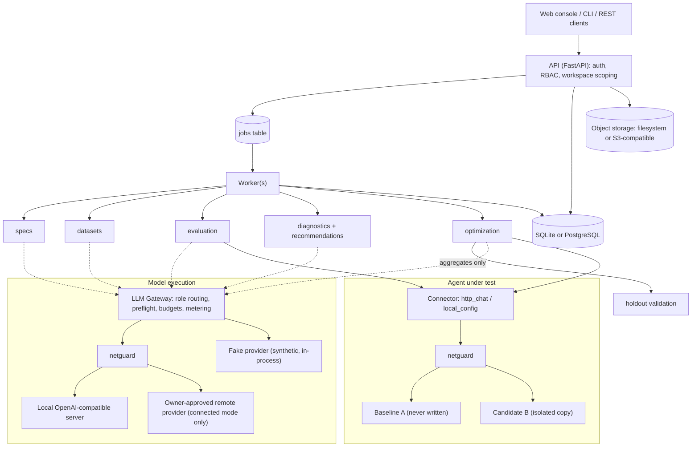

# Architecture

Kaizeval is a **modular monolith with background workers**. One Python package contains every
bounded context; the same code runs as a single process on a laptop or as separate API and worker
containers backed by PostgreSQL.

## Modules

| Module | Responsibility |
|---|---|
| `config`, `db`, `models`, `migrations` | Settings, sessions, the relational model, Alembic migrations |
| `security`, `netguard`, `audit` | Password hashing, tokens, secret encryption, log redaction; outbound network policy; audit trail |
| `jobs`, `handlers` | Database-backed job queue and the job handlers |
| `storage` | Object storage abstraction (filesystem, S3-compatible) |
| `gateway` | LLM Gateway: providers, prompts, output schemas, the fake provider |
| `connectors` | `AgentAdapter` contract, `http_chat` and `local_config` adapters, registry |
| `documents`, `ground_truth` | Parsing and chunking; `GroundTruthProvider` contract and the document provider |
| `services.specs` | Versioned specifications |
| `services.datasets` | Test generation, import, split, coverage, holdout access control |
| `services.evaluation` | Run execution, deterministic checks, judges, arbiter, summaries |
| `services.diagnostics` | Findings and recommendations |
| `services.optimization` | Candidate loop, gates, approvals, promotion |
| `services.holdout` | Independent holdout validation (the only automated holdout reader) |
| `services.stats`, `services.reporting` | Paired comparison; reports |
| `api` | REST routers |
| `sample_agent` | Bundled deterministic agent implementing the local candidate protocol |
| `cli` | `serve`, `worker`, `demo`, `ci`, `sample-agent`, `migrate` |

## Architecture decisions

**ADR-1. Modular monolith.** One deployable keeps a self-hosted installation small and the
boundaries are enforced in code (module imports, access tokens such as `HoldoutAccess`). Modules
call each other through functions, so a context can be moved to its own service later.

**ADR-2. Database-backed job queue instead of Celery + Redis.** Jobs are rows claimed with a
conditional `UPDATE`. This removes a broker from every installation, makes job state transactional
with the data it produces, supports pause/resume (`review_required`) and cancellation naturally,
and runs unchanged on SQLite and PostgreSQL. Trade-off: polling instead of push, and throughput
bounded by the database, which is adequate for evaluation workloads where the agent and the model
are the bottleneck. The `jobs` module is the only place that would change to adopt a broker.

**ADR-3. SQLite by default, PostgreSQL for multi-process deployments.** A single `pip install`
must be enough to try the product. SQLite (WAL mode) is used with the inline worker; the Compose
stack uses PostgreSQL with separate worker containers. All access goes through SQLAlchemy and
Alembic; no SQLite- or PostgreSQL-specific SQL is used.

**ADR-4. Filesystem object storage by default, S3-compatible optional.** Original documents are
stored through a `Storage` protocol under workspace-prefixed keys. MinIO or any S3-compatible
service can be enabled with `KAIZEVAL_STORAGE_BACKEND=s3`.

**ADR-5. Vite + React single-page console served by the API.** The console is a static bundle
shipped inside the Python wheel, so no Node.js runtime is needed in production and one process
serves everything. (The original blueprint proposed Next.js; a server-rendering framework would
add a second runtime without a benefit for an authenticated internal tool.)

**ADR-6. Local accounts in release 0.1.** Sign-in is email + password (scrypt) with signed
tokens. External identity providers (OIDC) are on the roadmap; the authentication dependency
(`api/deps.py:current_user`) is the single extension point.

**ADR-7. No vector database.** Evidence is located by document, section and character offsets.
Kaizeval evaluates an agent's answers; it does not need to reproduce the agent's retrieval stack.

**ADR-8. Structured logs, no telemetry.** Logs are JSON lines with a request id; request and
response bodies are never logged and credential-like strings are redacted. There is no metrics
exporter, usage reporting or license check. Operators can ship the logs wherever they want.

## Data model

Every customer-owned table has a `workspace_id`; every query filters on it and every object load
through the API re-checks it (`api/deps.py:scoped`).

`users`, `workspaces`, `memberships`, `secrets`, `model_providers`, `model_role_policies`,
`model_invocations`, `agents`, `documents`, `evidence_chunks`, `specifications`, `datasets`,
`test_cases`, `evaluation_runs`, `case_results`, `findings`, `recommendations`, `candidates`,
`candidate_patches`, `optimization_runs`, `experiments`, `approvals`, `audit_events`, `jobs`.

Versioned or immutable things: documents (version + SHA-256, superseded versions are kept),
specifications (each edit is a new row in a lineage), datasets (`version` increments on any
change; runs record the version they used), candidates (baseline snapshot + digest are stored).

## Key flows

### Evaluation
1. Resolve cases for the requested split. The holdout split needs a `HoldoutAccess` grant.
2. For model modes, verify that the required roles are routed to providers that passed preflight
   **before** the agent is invoked.
3. For each case: invoke the agent turn by turn; run deterministic checks; ask the judge(s) only
   for dimensions without a decisive deterministic result; in dual mode call the arbiter on
   disagreement or doubt about a critical case; compute the final per-dimension scores using the
   precedence *deterministic > model judge > not scored*; commit.
4. Summarise, then (regression runs only) build findings and recommendations.

### Optimization (state machine persisted in `optimization_runs.state`)
`init` → fresh baseline evaluation, create candidate through the connector →
`propose` → stop checks (target, rounds, stagnation, budgets), ask the optimizer role for one
patch, validate it against the connector's allowlist →
(`await_approval` in human-guided mode: the job pauses as `review_required`) →
`apply` → patch the candidate, re-verify the baseline digest, re-run the **whole** regression
set, compare pairwise with the baseline, apply the gates, keep or restore →
back to `propose` … → finalize → holdout validation (aggregates only) → candidate
`awaiting_decision`. Promotion is a separate API call that needs a recorded approval.

### Holdout isolation
- `services/datasets.py` exposes `regression_cases()` and `holdout_cases(access)`.
- A `HoldoutAccess` is created in exactly three places: `services/holdout.py` (final validation
  of an optimization run), `handlers.py` (a holdout run launched explicitly by an owner) and
  `api/knowledge.py` (the audited "open holdout" action for reviewers).
- `services/optimization.py` and `services/diagnostics.py` never import it; diagnostics refuse a
  holdout run. A test asserts that no holdout question ever appears in optimizer inputs, and that
  the optimizer module's source contains no holdout accessor.
- After a holdout result has informed a decision, the dataset is marked `holdout_exposed` and must
  be rotated before another optimization can use it.

Because this is one process, the isolation is enforced by code structure, permissions and tests,
not by an operating-system boundary. A person with database access can read holdout rows.

## Extension points

| To add | Implement | Register |
|---|---|---|
| An agent connector | `connectors.base.AgentAdapter` | `connectors.register_adapter` |
| A model provider kind | a branch in `gateway/core.py:_complete` | `PROVIDER_KINDS` |
| A ground-truth source | `ground_truth.GroundTruthProvider` | used by `services/datasets.py` |
| A job type | a function decorated with `jobs.handler` | import it in `handlers.py` |
| An identity provider | replace `api/deps.py:current_user` | |
| A storage backend | the `storage.Storage` protocol | `storage.get_storage` |

## Not in this release

A hosted multi-tenant service, managed models, billing, SQL/API ground-truth providers,
vendor-specific connectors, online (live-traffic) experiments, OIDC and Kubernetes manifests are
intentionally out of scope. See the roadmap in the README.
