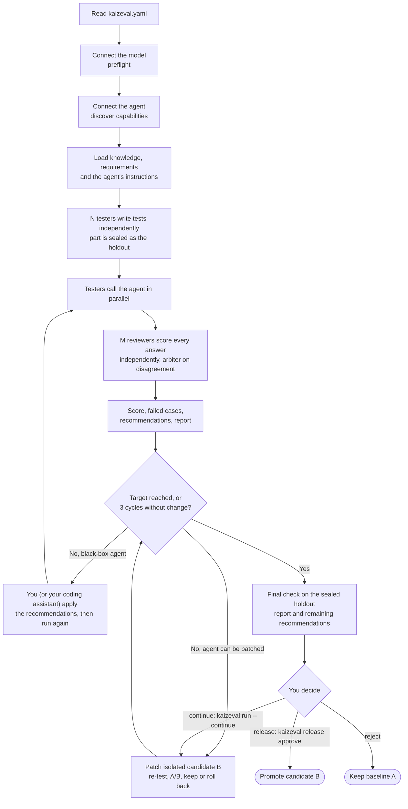

# Project mode: one file, one command

Project mode is the fastest way to use Kaizeval from a terminal, a CI job or a coding assistant.
You describe your agent in `kaizeval.yaml`; `kaizeval run` does the rest and can be repeated as
often as you like.

```bash
pip install kaizeval
kaizeval init          # writes kaizeval.yaml
kaizeval run           # connect, write tests, test, review, recommend, compare
```

No server has to be running: `kaizeval run` starts a local engine, stores its data in `.kaizeval/`
next to the project file and stops the engine when it is done. Add `.kaizeval/` to `.gitignore`.
To use a shared Kaizeval server instead, pass `--url` and set `KAIZEVAL_TOKEN` (or
`KAIZEVAL_EMAIL` and `KAIZEVAL_PASSWORD`).

## What `kaizeval run` does



1. **Model.** Registers the model endpoint and runs the preflight. Without a `model` block only
   deterministic checks and your own imported questions are used.
2. **Agent.** Registers the agent and verifies the connection.
3. **Knowledge, requirements, instructions.** Uploads the knowledge files, and builds a
   specification from `requirements`, `requirements_file` and `instructions_file`.
4. **Tests.** `tests.testers` independent testers each write their own share of the tests from
   their own passages, with their own angle (everyday user, edge-case hunter, sceptical auditor,
   ...). `tests.holdout_fraction` of the cases is sealed before anything else happens. The test set
   is created once and reused by later runs, so runs stay comparable.
5. **Testing.** The testers call the agent in parallel. Reviewers only start once the answers are in.
6. **Review.** `evaluation.reviewers` independent reviewers score every answer that rules cannot
   decide. When they disagree, or doubt a critical case, an arbiter decides or asks for a human.
7. **Result.** Scores by category, the failed cases with the reason, prioritised
   recommendations, and `kaizeval-report.md`.
8. **Comparison.** The first run becomes the baseline. Every later run is compared with it case by
   case and gets a verdict: `improved`, `regressed` or `inconclusive`.

Exit code `0` means the target score was reached, `1` that it was not, `2` an error.

## Reaching the target

`evaluation.target` is the score to reach on the regression set (default `1.0`, that is 100%).

**When the loop stops.** It keeps going as long as it makes progress. It stops when:

1. the target is reached; or
2. **three cycles in a row leave the score unchanged.** A change that is rolled back, rejected or
   already tried counts as an unchanged cycle. The loop then exits with the recommendations for
   what still fails and a report. The number is `optimize.stagnation_rounds`.

There is no fixed number of rounds by default. You can still add `optimize.max_rounds` or budgets
(`evaluation.max_model_calls`, `evaluation.max_agent_calls`) as extra limits, and you can cancel a
run at any time. Because a change is kept only when it really improves the score, the loop always
terminates. 100% is the goal, not a promise: when an agent cannot get there, you get the best
version found and an explanation of what is left.

**After it stops: continue, or release.** A stop is not the end unless you say so. Read
`kaizeval-report.md`, apply the recommendations you agree with (the ones Kaizeval could not apply
itself, such as a missing document or a code change), then choose:

| You want to | Command | What happens |
|---|---|---|
| Keep improving | `kaizeval run --continue` | The loop goes on **from candidate B**, with the changes it already kept. Because you may have changed the agent, baseline A and candidate B are both measured again first. It then runs until the target, or until three more cycles change nothing |
| Release what it reached | `kaizeval release approve` | Candidate B is promoted through the agent's connector |
| Drop it | `kaizeval release reject` | Baseline A stays; the candidate is closed |

Things to know about continuing:

- An approval given before you continue no longer applies: the candidate may change, so it needs
  a new decision.
- The sealed holdout informed the previous stop, so `kaizeval run --continue` generates a fresh
  one. The retired holdout cases join the regression set, which makes the set larger: scores
  from before and after the continuation are then not comparable, and the result says so
  (`scores_comparable_with_previous_run`).
- If the agent was restarted and lost its candidate copies, or you changed its default settings,
  the candidate is rebuilt: your new defaults plus the changes the loop had kept.
- `optimize.max_rounds`, when set, counts the cycles since the start or since the last
  continuation.
- A plain `kaizeval run` (without `--continue`) starts a new loop from the baseline.

**Who applies the fixes.** Kaizeval can always *measure* an agent, but it can only *change* an
agent that gives it a safe way to do so. That is the one thing that differs between agents:

| Your agent | What Kaizeval can do | How the loop runs |
|---|---|---|
| **A plain HTTP agent.** It only exposes a chat endpoint. Kaizeval can send questions and read answers, and has no access to its prompt, settings or code | Test it, score it, explain the failures, and write recommendations such as "add a rule to decline when the documents are silent" | **You close the loop**: you (or your coding assistant, which has your code open) apply the recommendations, restart the agent and run `kaizeval run` again. Every run is compared with the first one case by case, and three runs in a row with an unchanged score are reported as `stalled` (you can still go on with `kaizeval run --continue`, or release the agent as it is with your own process). When the target is met, `kaizeval run --holdout` does the final independent check |
| **An agent with the candidate protocol.** It also exposes a few admin endpoints that let Kaizeval create an isolated copy of its settings and change that copy | Everything above, plus try changes itself, on the copy only | **Kaizeval closes the loop** (`optimize.enabled: true`): one change per cycle on candidate B, the whole regression set re-tested, paired A/B against baseline A, kept only if every gate passes, then validated on the sealed holdout |

### Making your own agent automatic

You do not have to write the admin endpoints yourself. `kaizeval.agentkit` adds them to any
FastAPI agent in a few lines, and you decide which settings may be changed (for example the
system prompt, the number of retrieved passages, the temperature):

```python
from fastapi import FastAPI
from kaizeval.agentkit import CandidateStore

store = CandidateStore(
    defaults={"system_prompt": "You are a support assistant.", "top_k": 3},
    hints={"system_prompt": {"addresses": ["instruction_prompt", "citation"], "max_length": 2000},
           "top_k": {"min": 1, "max": 8, "addresses": ["retrieval_grounding"]}},
    state_file="agent-candidates.json",
)
app = FastAPI()
app.include_router(store.router(admin_token="choose-a-secret"))   # the candidate protocol

@app.post("/chat")
def chat(body: dict):
    version, settings = store.settings(body.get("version"))       # baseline, a candidate, or production
    answer = my_agent(body["message"], **settings)
    return {"answer": answer, "citations": [], "version": version, "config_digest": store.digest(version)}
```

Your baseline settings can never be modified through these endpoints, candidates are separate
copies, and promotion only moves a pointer. `examples/llm_agent.py` is a complete model-backed
agent built this way, with `examples/llm_agent.kaizeval.yaml` to test and improve it.

In both cases **the decision is yours**. After an automatic optimization the candidate waits
for you:

```bash
kaizeval run --continue     # keep improving from candidate B
kaizeval release approve    # promote candidate B through the agent's connector
kaizeval release reject     # keep baseline A
```

On an interactive terminal `kaizeval run` asks the question directly (continue, release, reject,
or decide later). In scripts and coding assistants (`--no-input`, or `--json`) it never asks,
never continues by itself and never promotes.

## `kaizeval.yaml` reference

| Key | Default | Meaning |
|---|---|---|
| `project` | `my-agent` | Name of the workspace |
| `network` | `offline` | `offline`: only local/private endpoints. `connected`: also public endpoints that you mark `allow_public` |
| `model.base_url`, `model.model` | none | Any OpenAI-compatible endpoint and the model name. Omit `model` to run without a model |
| `model.api_key_env` | none | Name of the environment variable that holds the API key (the key itself never goes in the file) |
| `model.allow_public` | `false` | Needed for a hosted provider, together with `network: connected` |
| `model.max_tokens`, `model.temperature`, `model.timeout_s` | `2000`, `0`, `300` | Output limit, temperature and timeout of every model call. Raise `max_tokens` for models that reason before answering |
| `knowledge` | none | Files, folders or patterns such as `docs/**/*.md`. A folder means every PDF, DOCX, Markdown and TXT file inside it |
| `model.kind` | `openai_compatible` | `fake` selects the built-in deterministic stand-in (results are SYNTHETIC). `aws_bedrock` uses Amazon Bedrock and needs `model.region` ([cloud platforms](CLOUD_PLATFORMS.md)) |
| `agent.platform` | none | Instead of `agent.url`, for an agent hosted on a cloud platform: `aws_bedrock_agent`, `aws_agentcore` or `salesforce_agentforce`. Its settings and `agent.credential_env` are listed in [cloud platforms](CLOUD_PLATFORMS.md) |
| `agent.url` | required | HTTP endpoint of the agent |
| `agent.style` | `simple` | `simple` (`{"message": ...}` → `{"answer": ...}`) or `openai` (chat completions) |
| `agent.response_path`, `agent.citations_path` | `answer`, `citations` | Where the answer and citations are in the response JSON |
| `agent.api_key_env` | none | Environment variable with the agent's credential |
| `agent.candidate_protocol`, `agent.admin_token_env` | `false` | The agent implements the candidate admin API |
| `requirements`, `requirements_file` | empty | What the agent must do, in plain language |
| `instructions_file` | none | The agent's own instructions (system prompt) |
| `knowledge` | `[]` | Glob patterns of PDF, DOCX, Markdown and text files |
| `tests.cases` | `30` | Number of generated test cases |
| `tests.testers` | `3` | Independent tester agents, 1 to 8 |
| `tests.holdout_fraction` | `0.3` | Share of cases sealed as the holdout |
| `tests.languages` | `[]` | Also ask the questions in these languages or dialects |
| `tests.import` | `[]` | Your own approved questions (CSV or JSON Lines) |
| `evaluation.reviewers` | `2` | Independent reviewer agents per answer, 0 to 7 (0 = rules only) |
| `evaluation.target` | `1.0` | Regression score to reach |
| `evaluation.require_citations` | `true` | Score whether answers cite the right source (a returned citation list, or the document named in the answer) |
| `evaluation.repeats` | `1` | Ask every question this many times and average the scores. Use 2 or more for agents whose answers vary between runs |
| `evaluation.max_agent_calls`, `evaluation.max_model_calls` | none | Budgets |
| `optimize.enabled` | `false` | Automatic improvement of an isolated candidate |
| `optimize.stagnation_rounds` | `3` | Stop when this many cycles in a row leave the score unchanged. For a plain HTTP agent: report `stalled` after this many runs in a row with an unchanged score |
| `optimize.max_rounds` | none | Optional extra limit on the number of cycles |

To mix two models as reviewers, assign a different model to the `evaluator_secondary` role in the
console (Models → role routing): reviewers alternate between the two evaluator roles.

## Use it from a coding assistant

Any assistant that can run a terminal command can use Kaizeval as it is:

```bash
kaizeval run --json --no-input
```

prints one JSON object with `overall`, `target_met`, `stalled`, `decision_options`, `failures`,
`recommendations`, `comparison_with_baseline` and `next_steps`, while progress goes to stderr.
`decision_options` lists what you can choose once the loop has stopped (`continue`, `release`,
`reject`); it is empty while there is nothing to decide. A typical instruction to give your
assistant: *"Run `kaizeval run --json --no-input`, apply the recommendations to the agent, restart
it and run again until `target_met` is true, `stalled` is true or `decision_options` is not empty.
Then show me the report and ask me whether to continue (`kaizeval run --continue`) or to release.
Do not continue or release anything without asking me."*

For assistants that support the Model Context Protocol, Kaizeval ships an MCP server:

```bash
pip install "kaizeval[mcp]"
```

```json
{
  "mcpServers": {
    "kaizeval": { "command": "kaizeval", "args": ["mcp"] }
  }
}
```

| Tool | What it does |
|---|---|
| `init_project` | Creates `kaizeval.yaml` |
| `evaluate_agent` | Runs the journey and returns the result (same JSON as `kaizeval run --json`). With `continue_improvement: true` the stopped loop goes on from its candidate |
| `last_result` | Returns the previous result without running anything |
| `release_candidate` | Records the **user's** approve or reject decision for a candidate |

The server's instructions tell the assistant to stop when the loop stops, show you the report, and ask
you whether to continue or to release.

## Commands

| Command | Purpose |
|---|---|
| `kaizeval init [dir] [--force]` | Write a commented `kaizeval.yaml` |
| `kaizeval run [-c file] [--continue] [--holdout] [--regenerate] [--reset-baseline] [--json] [--no-input] [--url URL]` | Run the journey. `--continue` keeps improving from where the loop stopped |
| `kaizeval release approve\|reject [-c file] [--note text]` | Decide on the candidate of the last optimization |
| `kaizeval mcp` | Serve the MCP tools over stdio |
| `kaizeval serve` | Open the web console and API (for browsing results, human review and human-guided optimization) |

The console and project mode use the same engine. To browse a project's results in the console,
run `KAIZEVAL_DATA_DIR=.kaizeval kaizeval serve` in the project folder and sign in with the local
account stored in `.kaizeval/project-state.json`.
