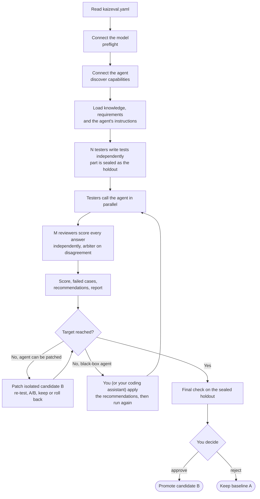

# Project mode: one file, one command

Project mode is the fastest way to use Kaizeval from a terminal, a CI job or a coding assistant.
You describe your agent in `kaizeval.yaml`; `kaizeval run` does the rest and can be repeated as
often as you like.

```bash
pip install kaizeval-0.1.0-py3-none-any.whl
kaizeval init          # writes kaizeval.yaml
kaizeval run           # connect, write tests, test, review, recommend, compare
```

No server has to be running: `kaizeval run` starts a local engine, stores its data in `.kaizeval/`
next to the project file and stops the engine when it is done. Add `.kaizeval/` to `.gitignore`.
To use a shared Kaizeval server instead, pass `--url` and set `KAIZEVAL_TOKEN` (or
`KAIZEVAL_EMAIL` and `KAIZEVAL_PASSWORD`).

## What `kaizeval run` does



1. **Model.** Registers the model endpoint and runs the preflight. Without a `model` block only
   deterministic checks and your own imported questions are used.
2. **Agent.** Registers the agent and verifies the connection.
3. **Knowledge, requirements, instructions.** Uploads the knowledge files, and builds a
   specification from `requirements`, `requirements_file` and `instructions_file`.
4. **Tests.** `tests.testers` independent testers each write their own share of the tests from
   their own passages, with their own angle (everyday user, edge-case hunter, sceptical auditor,
   ...). `tests.holdout_fraction` of the cases is sealed before anything else happens. The test set
   is created once and reused by later runs, so runs stay comparable.
5. **Testing.** The testers call the agent in parallel. Reviewers only start once the answers are in.
6. **Review.** `evaluation.reviewers` independent reviewers score every answer that rules cannot
   decide. When they disagree, or doubt a critical case, an arbiter decides or asks for a human.
7. **Result.** Scores by category, the failed cases with the reason, prioritised
   recommendations, and `kaizeval-report.md`.
8. **Comparison.** The first run becomes the baseline. Every later run is compared with it case by
   case and gets a verdict: `improved`, `regressed` or `inconclusive`.

Exit code `0` means the target score was reached, `1` that it was not, `2` an error.

## Reaching the target

`evaluation.target` is the score to reach on the regression set (default `1.0`, that is 100%).

**100% is a target, not a promise.** Some agents cannot reach it, and a loop that never stops is
not safe to run. The loop therefore also ends when nothing improves any more, when the round or
budget limits are hit, or when you cancel it, and it always reports why it stopped.

How the loop runs depends on what your agent allows:

| Your agent | Who applies the fixes | How the loop runs |
|---|---|---|
| Any HTTP agent (black box) | You, or your coding assistant | `kaizeval run` → apply the recommendations → `kaizeval run` again. Each run shows the paired A/B against the baseline. When the target is met, run `kaizeval run --holdout` once for the independent check |
| Implements the [candidate protocol](CONNECTOR_SDK.md) (`candidate_protocol: true`) | Kaizeval, on an isolated copy | With `optimize.enabled: true` the loop is automatic: one allowlisted change per round on candidate B, the whole regression set re-tested, paired A/B against baseline A, kept only if every gate passes, then validated on the sealed holdout |

In both cases **the release decision is yours**. After an automatic optimization the candidate
waits for you:

```bash
kaizeval release approve    # promote candidate B through the agent's connector
kaizeval release reject     # keep baseline A
```

On an interactive terminal `kaizeval run` asks the question directly. In scripts and coding
assistants (`--no-input`, or `--json`) it never asks and never promotes.

A/B for a black-box agent that you deploy twice (old and new version on two URLs) works the same
way: point `agent.url` at the new version and run again; the comparison is against the baseline run.

## `kaizeval.yaml` reference

| Key | Default | Meaning |
|---|---|---|
| `project` | `my-agent` | Name of the workspace |
| `network` | `offline` | `offline`: only local/private endpoints. `connected`: also public endpoints that you mark `allow_public` |
| `model.base_url`, `model.model` | none | Any OpenAI-compatible endpoint and the model name. Omit `model` to run without a model |
| `model.api_key_env` | none | Name of the environment variable that holds the API key (the key itself never goes in the file) |
| `model.allow_public` | `false` | Needed for a hosted provider, together with `network: connected` |
| `model.kind` | `openai_compatible` | `fake` selects the built-in deterministic stand-in (results are SYNTHETIC) |
| `agent.url` | required | HTTP endpoint of the agent |
| `agent.style` | `simple` | `simple` (`{"message": ...}` → `{"answer": ...}`) or `openai` (chat completions) |
| `agent.response_path`, `agent.citations_path` | `answer`, `citations` | Where the answer and citations are in the response JSON |
| `agent.api_key_env` | none | Environment variable with the agent's credential |
| `agent.candidate_protocol`, `agent.admin_token_env` | `false` | The agent implements the candidate admin API |
| `requirements`, `requirements_file` | empty | What the agent must do, in plain language |
| `instructions_file` | none | The agent's own instructions (system prompt) |
| `knowledge` | `[]` | Glob patterns of PDF, DOCX, Markdown and text files |
| `tests.cases` | `30` | Number of generated test cases |
| `tests.testers` | `3` | Independent tester agents, 1 to 8 |
| `tests.holdout_fraction` | `0.3` | Share of cases sealed as the holdout |
| `tests.languages` | `[]` | Also ask the questions in these languages or dialects |
| `tests.import` | `[]` | Your own approved questions (CSV or JSON Lines) |
| `evaluation.reviewers` | `2` | Independent reviewer agents per answer, 0 to 7 (0 = rules only) |
| `evaluation.target` | `1.0` | Regression score to reach |
| `evaluation.require_citations` | `true` | Score whether answers cite the right source |
| `evaluation.max_agent_calls`, `evaluation.max_model_calls` | none | Budgets |
| `optimize.enabled` | `false` | Automatic improvement of an isolated candidate |
| `optimize.max_rounds`, `optimize.stagnation_rounds` | `10`, `3` | Safety caps for the loop |

To mix two models as reviewers, assign a different model to the `evaluator_secondary` role in the
console (Models → role routing): reviewers alternate between the two evaluator roles.

## Use it from a coding assistant

Any assistant that can run a terminal command can use Kaizeval as it is:

```bash
kaizeval run --json --no-input
```

prints one JSON object with `overall`, `target_met`, `failures`, `recommendations`,
`comparison_with_baseline` and `next_steps`, while progress goes to stderr. A typical instruction
to give your assistant: *"Run `kaizeval run --json --no-input`, apply the recommendations to the
agent, restart it and run again until `target_met` is true. Do not release anything without
asking me."*

For assistants that support the Model Context Protocol, Kaizeval ships an MCP server:

```bash
pip install "kaizeval[mcp]"
```

```json
{
  "mcpServers": {
    "kaizeval": { "command": "kaizeval", "args": ["mcp"] }
  }
}
```

| Tool | What it does |
|---|---|
| `init_project` | Creates `kaizeval.yaml` |
| `evaluate_agent` | Runs the journey and returns the result (same JSON as `kaizeval run --json`) |
| `last_result` | Returns the previous result without running anything |
| `release_candidate` | Records the **user's** approve or reject decision for a candidate |

The server's instructions tell the assistant to ask you before any release.

## Commands

| Command | Purpose |
|---|---|
| `kaizeval init [dir] [--force]` | Write a commented `kaizeval.yaml` |
| `kaizeval run [-c file] [--holdout] [--regenerate] [--reset-baseline] [--json] [--no-input] [--url URL]` | Run the journey |
| `kaizeval release approve\|reject [-c file] [--note text]` | Decide on the candidate of the last optimization |
| `kaizeval mcp` | Serve the MCP tools over stdio |
| `kaizeval serve` | Open the web console and API (for browsing results, human review and human-guided optimization) |

The console and project mode use the same engine. To browse a project's results in the console,
run `KAIZEVAL_DATA_DIR=.kaizeval kaizeval serve` in the project folder and sign in with the local
account stored in `.kaizeval/project-state.json`.
