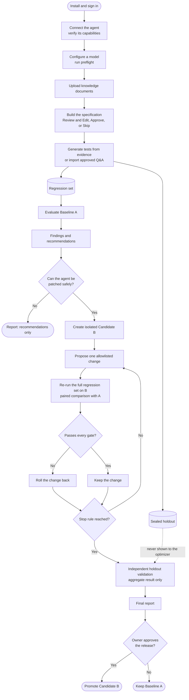
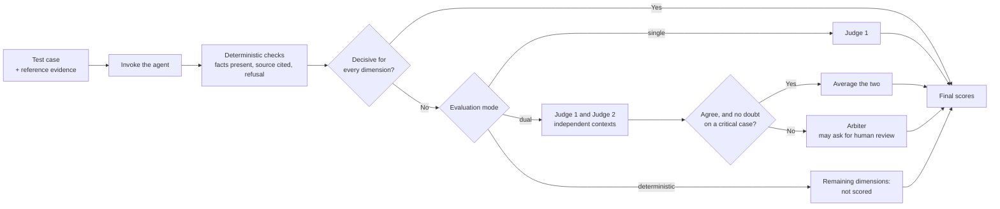
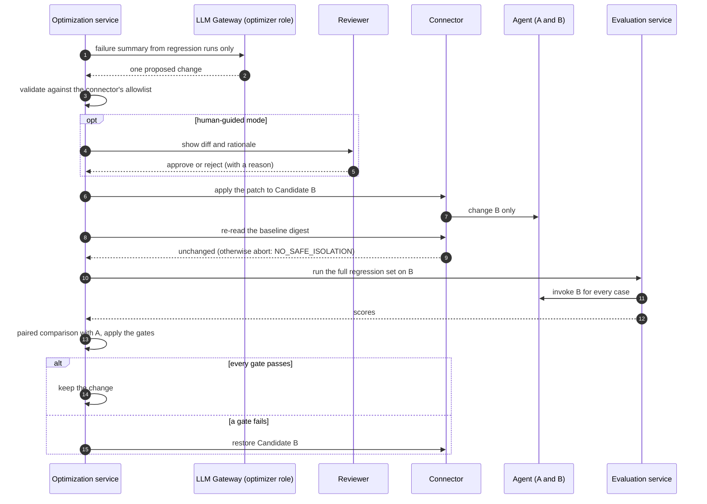
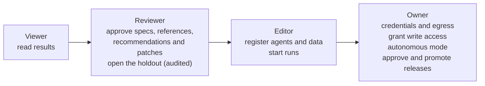

# Workflow

How a team uses Kaizeval from the first connection to a release decision, and what the system
does at each step. The component view is in [ARCHITECTURE.md](ARCHITECTURE.md).

## 1. The whole journey

| Step | Who | What Kaizeval guarantees |
|---|---|---|
| Connect the agent | Editor (owner for write access) | Only capabilities that the connector implements **and** the customer granted are offered |
| Configure a model | Owner / editor | No AI-assisted step runs on a model that has not passed preflight; no silent fallback |
| Upload knowledge | Editor | Every passage keeps file, version, SHA-256, page or section and offsets |
| Specification | Reviewer | The choice (approve or skip) is recorded with the person and time; edits create new versions |
| Tests | Editor / reviewer | The split into regression and holdout happens before any optimization |
| Evaluate | Editor | Deterministic checks and approved references outrank model judges |
| Optimize | Editor (owner for autonomous) | Only Candidate B is written; the whole regression set is re-run every round |
| Validate | Automatic | The optimizer never sees holdout questions, references or per-case results |
| Release | Owner | Nothing is promoted without an explicit, recorded approval |

The number of tester agents (1 to 8) and reviewer agents (0 to 7) is yours to choose, per dataset
and per run. Testers write and run the tests independently; reviewers start only after the
testers' answers are in. The quickest way to run this whole journey is one file and one command:
see [PROJECT_MODE.md](PROJECT_MODE.md).

## 2. How one answer is scored

Precedence for each dimension: a decisive deterministic result, then a model judgment (labelled
as an estimate), otherwise "not scored". A case whose main dimension cannot be observed is
reported as `n/a` instead of receiving a guessed score.

## 3. One optimization round

Gates: minimum improvement over the best version so far, no new critical failure, no category
dropping more than the tolerance, optional per-category minimums and a latency limit. The loop stops when
the target score is reached or when two cycles in a row leave the score unchanged; an optional round limit, model and agent budgets and cancellation can end it earlier. It always exits with the recommendations for what still fails.

## 4. Roles and decisions

Each role includes the permissions of the roles to its left.
